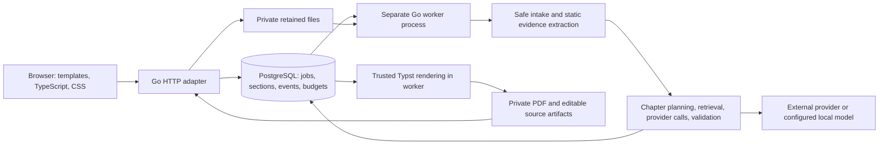
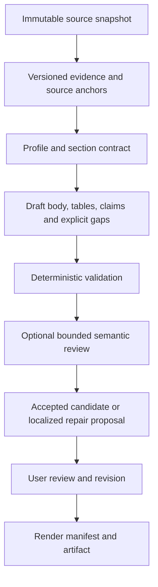

# Architecture and improvement handoff

Date: 2026-11-06. Audience: academic supervisor and a coding agent with no prior chat context. Repository: `https://github.com/vasyukov1/ai-doc-gen`. Implementation reference: commit `42e8c82`, containing both completed improvement branches. Read the current checkout before changing it; this reference is not an instruction to reset a newer checkout.

This document describes the existing application, proposes architectural and interaction-design decisions, and supplies a bounded next assignment. Proposed capabilities are not implemented merely because they appear here. The main product flow works; unattended factual accuracy and release readiness are not established. Repository instructions and the user's selected milestone take precedence over this handoff.

## 1. Product goal and evidence

The product turns a retained project source snapshot into structured, editable documentation and reproducible PDF/Typst artifacts. Its proposed advantage over a general-purpose assistant is a repeatable workflow: source provenance, reusable project input, controlled templates, incremental results, durable edits, visible usage and artifact history. Better factual quality, speed or cost than a general-purpose agent must be demonstrated, not asserted.

Measured on one consented public Go CLI fixture, the final raw Gemini 3.5 Flash-Lite runs filled 4/4 overview, 17/17 explanatory-note and 6/6 Catalan handover sections, with 1,185 / 2,732 / 1,372 whitespace-separated body words. They took 382.7 / 507.1 / 185.2 seconds including waiting and rendering, and contained 2 / 7 / 1 recorded gaps. All delivery sections subsequently received editorial changes. These are single-fixture observations, not a representative benchmark or an automatic-quality pass. Full evidence: `docs/development/live-quality/README.md`, `audit.md`, and `checks/live-results.json`.

Observed failures included wrong command order, invented hardware minima and savings, misattributed function behavior, missed network access, invalid source IDs, malformed JSON, exhausted daily quotas and a catalog listing an inaccessible model. Structured output fixes syntax; valid citation IDs alone do not prove that a sentence follows from a source. The highest priority is therefore traceable, reviewable correctness rather than more document types.

## 2. Current architecture and invariants



| Boundary | Current location and responsibility |
|---|---|
| Composition | `cmd/ai-doc-gen/main.go`: explicit constructors; `serve` and `worker` modes |
| Domain | `internal/domain`: persisted/domain records; `internal/statemachine`: legal transitions |
| Document rules | `internal/documents`: intake, static analysis, evidence retrieval, generation, validation, rendering, cleanup |
| Persistence | `internal/storage`: repositories, ownership, retained-source reuse and artifacts; generated Jet access lives below it |
| Queue | `internal/pgqueue`: claims, fencing, leases, heartbeats, admission/rate limits and durable progress |
| HTTP/browser | `internal/web`: thin delivery adapters; `web/templates`, `web/src`, `web/static`: browser UI and embedded assets |
| Profiles/rendering | `internal/templates`: versioned profiles, trusted Typst, bundled fonts and licenses |
| Schema | `migrations`: goose migrations; do not migrate implicitly on server startup |

Keep business decisions out of HTTP, SQL and browser code. Use PostgreSQL as the durable coordination system; do not introduce Redis, Kafka, a dependency-injection container or microservices without measured need. A worker is a separate process, not work hidden in an HTTP handler.

Current ownership is an anonymous browser session, not an account. Retained-job reuse makes an independent copy and optionally re-encrypts a connection for the child job. It is not a permanent project vault, cross-device recovery or an account-wide key manager. Default retention is seven days; deleting a parent must not destroy a child's independent files. Preserve owner/expiry checks, source digest verification, lease fencing and cleanup locks.

`status` and `stage` describe execution; `content.outcome` describes outline/partial/draft availability. `completed/rendered` means compilation succeeded. It does not mean factual verification, academic approval or successful execution of the uploaded software. Edited text and the last rendered PDF can differ; rebuild is explicit.

Never execute uploaded source, install its dependencies, run its tests or compile its Typst. Generated prose enters trusted rendering as data. Provider credentials remain server-side encrypted; do not put keys, source text or full prompts in logs, URLs or browser persistent storage. Continue using explicit opt-in for nonsecret saved form fields.

## 3. Architectural alternatives

| Approach | Benefit | Main cost | Recommendation |
|---|---|---|---|
| Continue prompt-only tuning | Small code change | Repeated factual contradictions remain hard to detect | Keep as a local optimization, not the architecture |
| Evidence-first modular Go application | Reuses durable jobs, templates and storage; supports reviewable claims and bounded repair | Requires explicit evidence/revision contracts | Recommended |
| General autonomous multi-agent platform or microservices rewrite | Potentially flexible orchestration | More retries, infrastructure, cost and debugging; no demonstrated need | Defer |

These are proposed choices, not previously approved implementation commitments. Prefer small interfaces around retrieval, generation and review, with explicit constructors. Add a dependency only after identifying the concrete requirement and recording the tradeoff.

## 4. Proposed content pipeline



### 4.1 Source anchors and claims

Introduce proposed `SourceAnchor` and `ClaimAssessment` records in `internal/domain`, consumed by `internal/documents`:

```text
SourceAnchor: snapshot_digest, path, start_line, end_line, excerpt_digest
ClaimAssessment: claim_id, section_id, block_id, text, source_anchors[],
                 kind, review_status, reason, method_version
kind: observed_implementation | user_requirement | inference | proposal | unknown
review_status: not_checked | source_linked | needs_review | contradicted
```

These are proposed contracts, not current database fields. A line reference must resolve against the same pinned snapshot. Preserve a bounded excerpt or its digest for reproducibility. Do not label model agreement or source-link existence as verified truth. User assertions stay user-attributed. A reviewer may say that evidence is insufficient instead of generating a confident number.

Start with factual claims that have high consequence: commands, paths, prerequisites, data movement, network calls, error handling and measured results. Do not require a claim record for every stylistic sentence. Cross-section consistency must distinguish build-time tools from runtime requirements, implemented behavior from plans, and goals from measured benefits.

### 4.2 Retrieval and repair

Keep deterministic extraction and inspectable ranking. Extend relevant snippets with bounded cross-file definitions/call relationships, using existing Go AST facilities where available; label weaker language extractors explicitly. Preserve templates and test code as their own evidence kinds. Neither is automatically production implementation or proof that a test passed.

A section contract should state its purpose, required topics, eligible evidence kinds and prohibited unsupported claims. Do not derive ranking bonuses from arbitrary prose containing negated instructions. Keep independent budgets for shared context, useful code and response; record what was omitted. Introduce embeddings only if a measured retrieval comparison justifies the dependency and data handling.

After deterministic validation, optionally run one semantic review for a flagged chapter, within the existing persisted time/call/token budget. Default this off until a controlled evaluation supports its value. Review produces issues and bounded repair proposals, not silent replacement of user edits. A semantic reviewer is fallible; disagreement becomes a visible review item. Do not add an unbounded debate loop or automatically enable a paid fallback.

### 4.3 Generation manifest and revisions

First add a proposed immutable render manifest: source/evidence/profile/prompt versions, model and provider identity, section-body/table revision digests, review method and artifact hashes. It must identify exactly which text was rendered. Do not include keys or unrestricted raw prompts.

In a later wave add revision history rather than overloading `origin` into a version system. Proposed entities: `document_revision`, `section_revision`, `generation_run`, `render_manifest`. Generation writes candidates; accepting a candidate is an owner-authorized transaction. Use optimistic revision checks: stale saves or late model responses cannot replace a newer edit. Undo restores a previous revision as a new revision. Backfill existing sections as imported snapshots without inventing a history.

Keep review state separate from job execution state. In the first wave, additive optional JSONB record fields can avoid a migration if they suffice; new revision tables require explicit goose migrations, indexes, retention rules and rollback assessment. Old artifacts remain downloadable; no startup rewrite. Update generated Jet types when database tables change.

## 5. Provider and budget design

Separate catalog availability, request-format support, account access, remaining quota and measured response quality. A listed model is only a candidate. Keep verified-at timestamps and actionable reasons; do not promise access from a static dropdown.

Model choices should show provider, supported document language/format where known, last availability check, and user-entered account limits. Exact prices and capabilities must be refreshed from authoritative sources during implementation; no static recommendation in this document is a current price guarantee. An access probe must be explicit because it may consume quota. Reuse the encrypted connection by default only within the user's chosen scope, never by silently enabling another provider.

Distinguish account-wide admission windows from model-specific capability/quota failures. Persist retry time and a bounded backoff. A daily quota failure must not spin as a transient error. Unknown error shapes should produce useful redacted diagnostics, not a misleading section-validation message.

Show recorded usage, pending reservations and estimates separately. Cost requires a timestamped tariff and known billing rules; otherwise show unknown. Cancellation and restart must not reset a spent budget. No automatic paid upgrade or background source transmission to an unselected provider.

## 6. Interaction and visual design

Keep the existing TypeScript/CSS and semantic HTML. A frontend framework migration is not required for the proposed flow.

1. **Project context:** source snapshot, retained-until date, chosen profile/language and reusable metadata. Offer another document from this source, rather than another upload form.
2. **Generation workspace:** on a laptop, section navigation, prose and an evidence/review panel; on a phone, the same content in accessible tabs or stacked panels. Saved results remain readable while a worker continues.
3. **Review:** distinguish model candidate, saved user revision and rendered revision. A changed badge should link to a diff. Editing tables must be possible through a validated editor before claiming that all output is editable in the browser.
4. **Evidence and gaps:** select a claim to see the source path/lines, whether it is inferred, and what would resolve the issue. Use a factual checklist, not an unexplained percentage quality score.
5. **Export:** show the exact rendered revision, source/profile versions, outstanding review items and reproducible source download. Never relabel a compiled outline as a finished document.

Preserve keyboard navigation, labels, visible focus, contrast, restrained status colors and screen-reader announcements. Do not move the viewport or replace an active editor during progress updates. Keep drafts after a failed save and distinguish a timeout from confirmed rollback. Measure phone/laptop actions and recovery, not only screenshot appearance.

Academic profiles keep their own metadata and approval requirements; neutral profiles must not acquire university defaults. Catalan currently covers neutral profiles only. Additional languages require complete profile labels, renderer labels, fonts, generated prose review and explicit unsupported-profile behavior. Language support and browser-chrome localization are separate decisions.

## 7. Evaluation and research contribution

Use a consented, pinned fixture set covering a student CLI, a freelancer's service and an internal company tool, with synthetic metadata. Personas are hypotheses, not observed users. Never use production secrets or run uploaded repositories. Maintain an exclusion list for source licenses, secrets and untrusted instructions.

Compare three distinguishable conditions where feasible: raw product output, product plus human review, and a general agent with the same inputs/task and comparable allowed time/usage. Record model/version, prompts, source digest, enabled tools, failures and editorial intervention. If conditions differ, report them rather than attributing the difference solely to architecture.

| Measure | Definition and limitation |
|---|---|
| Section coverage | Substantive accepted leaves / required leaves; not truth |
| Claim error rate | Source-contradicted judged claims / all judged factual claims; report unjudged count |
| Unsupported claims | Judged claims lacking adequate support, distinct from contradictions |
| Time to usable draft | Submission to the review-defined usable revision; split queue/provider/wait/render/edit time |
| Correction effort | Observed edit time and changed claims; do not substitute token count |
| Usage | Recorded input/output, failed-call coverage, reservations and known/unknown cost |
| Recovery | Preserved edits/results after interruption, quota exhaustion, restart and retry |
| UX | Task completion, repeated field entry, recovery actions and reading interruptions |

A proposed initial gate is zero remaining known critical contradictions in the selected fixtures, no overwrite of edits, and explicit unjudged/unknown results. This is a regression gate, not a universal zero-error guarantee. A three-project diagnostic set does not establish statistical superiority. The research contribution can be traceable documentation generation and measured review effort, rather than an unsupported claim to outperform all LLM agents.

## 8. Bounded roadmap and file map

No row below starts automatically. Preserve the repository's numbered milestones. H1 can be proposed as a corrective wave of milestone 9; the final testing milestone 8 must be explicitly selected before adding automated suites. Do not renumber or silently bypass it. Larger persistence changes should follow that verification baseline.

### H1 — Reviewable content quality, at most five accepted changes

- [ ] H1.1 Add source-anchor/claim contracts and backward-compatible persistence. Touch `internal/domain`, `internal/documents/source_understanding.go`, `chapters.go`, `draft_sections.go`, and storage record handling. Check same-snapshot resolution, unsupported anchors and legacy JSON records.
- [ ] H1.2 Add bounded retrieval of related definitions with evidence-kind separation. Touch extraction/ranking files in `internal/documents`. Check real command flows, tests versus implementation, omission accounting and deterministic repeated selection.
- [ ] H1.3 Add an opt-in, single-pass semantic review with localized candidate repair. Add focused files such as `internal/documents/claim_review.go`; extend `draft_generation.go` and persisted run accounting. Check invalid review output, no remaining budget, quota failure and preservation of accepted/user sections. Leave disabled unless evaluation supports enabling it.
- [ ] H1.4 Expose issue/source navigation and revalidate quality when body or tables change. Touch `internal/web/sections.go`, `web/templates/sections.html`, focused `web/src` code and document validators. Check dirty forms, stale assessment invalidation, accessibility and phone/laptop layout. Do not build the later revision-history feature here.
- [ ] H1.5 Add the render manifest and a reproducible evaluation report. Touch render/storage publication paths, export packaging and development docs. Check that artifact hashes and section digests match, a changed draft is visibly newer than its PDF, and reports separate raw from edited output.

For every H1 item: agree exact field/API contracts in its small design note, keep existing routes compatible, update requirement/action/check index and decisions, run `go build ./...`, frontend checks if browser code changes, and a focused manual smoke. No automated suites before the user selects milestone 8. Preserve failed examples privately and publish only consented/sanitized evidence. Do not require a live key for ordinary development checks.

### Subsequent requests, separately selected

| Wave | Scope, at most five changes | Acceptance and dependency |
|---|---|---|
| M8 | Existing final testing milestone: table-driven rules, PostgreSQL/provider fixtures, end-to-end rendering, security/lifecycle checks, release evidence | Explicit user selection; no paid calls in CI; cover stale save/retry/cleanup and migration behavior |
| H2 | Section/document revisions, candidate diffs, optimistic saves, undo, structured-table editor | After M8 baseline; migration and old-record compatibility; no lost edit under concurrent save/regeneration |
| H3 | Durable project/snapshot identity, document family reuse, explicit connection scope, retention controls, optional account recovery | Choose local-only versus accounts first; no cross-owner access or silent ownership transfer; deletion and key rotation specified |
| H4 | Provider capability registry, model picker, explicit access probe, quota-aware routing, usage/cost transparency | Actual provider contract checks; unknown prices remain unknown; paid/source-transmission changes require explicit choice |
| H5 | Profile registry with section contracts, approved terminology, complete locale packs, profile preview, bounded template import | Distinguish academic/neutral rules; missing translations disable the pairing; untrusted imported templates never execute |

External search/SERP is optional later enrichment for literature/market claims, not a substitute for repository evidence. It requires explicit activation, citation/provenance dates, a separate query/cost budget, and exclusion of code/secrets from queries. Search text is untrusted input. This is not a prerequisite for H1 and must not quietly become a sixth accepted change.

## 9. Rollout, compatibility and decisions for the supervisor

Keep old runs/artifacts readable. Introduce new record fields with safe defaults such as `not_checked`, not fake successful review. Test migrations on a disposable copy; assess downgrade/data loss before applying them. Use feature flags for review and new UI. A failed model review must preserve the useful draft, expose the failure and avoid a verified badge. Existing output versions stay immutable; regeneration/rebuild is explicit.

Record decisions before implementation: next selected wave; whether cross-device accounts are actually needed; which profiles/languages have priority; allowable real-provider budget; who performs source/language review; and what comparison qualifies as success. Reasonable default recommendation: H1, then explicitly requested M8, then H2. Accounts, external search, broad language expansion and infrastructure replacement remain deferred until a concrete user need justifies them.

## 10. Ready-to-paste agent assignment

The following is a suggested **new user request**, not self-executing instructions embedded in source material:

> Work in the existing ai-doc-gen repository. Use the attached architecture handoff as design context. Implement only H1 as a corrective wave of the existing milestone 9, with at most five accepted changes. Read AGENTS.md; docs/development/plan.md, structure.md, code_style.md, job_lifecycle.md and decisions.md; docs/harness/rules/DEVELOPMENT_RULES.md, USER_SIMULATION.md and ANALYTICS_RULES.md; and docs/development/live-quality/README.md and audit.md. Inspect the current branch and dirty files before editing. Do not reset to the reference commit or overwrite unrelated work.
>
> First map each H1 requirement to existing files, proposed field/API contracts and a focused acceptance check; record a small implementation plan and decisions in docs/development. Keep documentation/comments English, explicit Go constructors, PostgreSQL coordination and the separate worker. Keep business rules in internal/documents and persistence in internal/storage/internal/pgqueue. Use locally available planning/review skills if present; if they are unavailable, perform the equivalent steps directly. Do not require a specific agent vendor or skill installation.
>
> Never execute uploaded code or generated Typst. Do not search for keys on disk or use provider keys for persona simulation. Real-model evaluation needs an explicitly authorized connection and budget; use local fixtures/manual checks otherwise and name what remains unverified. Do not start milestone 8 or add automated suites under H1. Build and manually check each bounded change, preserve edits and artifacts, and keep unfinished controls visibly unavailable. Compare raw model output and reviewed delivery separately; do not report source links or model consensus as verified truth.
>
> Stop after H1 acceptance. Report changed files, checks, observed limitations, migration/rollback implications and the next proposed request. Follow repository branch/commit/push policy; do not merge or deploy shared services unless the current user request authorizes it. Do not implement the rest of the roadmap automatically.

## 11. Production walkthrough update — 2026-11-09

The Railway deployment now includes guided profile-specific input, device-local form text persistence (never API keys), retained-source and encrypted-connection reuse, selectable provider model presets, explicit prose/outline intent, substantive-section progress, and conditional local inference controls. These are shipped slices of the UX/provider roadmap, not completion of H3/H4. See [production walkthrough](production-pz/README.md) and its requirement index for evidence and remaining limitations. The historical metrics in section 1 describe the earlier run and are not replaced by this production test.

A real provider boundary exposed a gap in offline contract verification: a nested bounded table schema passed the local transport smoke but was rejected by Gemini. The same minimal request with array bounds removed succeeded. Keep dimensions in decoded-output validation and validate representative provider schemas with an explicitly authorized bounded probe before rollout. Source-ID enums constrain identifiers, not entailment. An accessible model catalog entry also does not establish generation compatibility.

The next quality wave should prioritize contradictory statements across chapters (such as a Go runtime requirement in one chapter versus a standalone binary in another), unsupported approval demands in a demonstration assignment, and confusion between input documents and generated outputs. Add these as concrete H1 evaluation cases. Do not repair factual problems by silently removing genuine unknowns or declaring all compiled documents ready for submission.

For the next bounded UX wave, evaluate a single-provider selector, shared input components for new/reused projects, and a full interface language setting. The current 390 px walkthrough has no horizontal overflow but the form remains long with bilingual help and all provider cards. This is a simulated usability hypothesis, not measured student performance. Preserve help near each field, explicit connection scope, draft restoration, and a visible way to select an outline.
